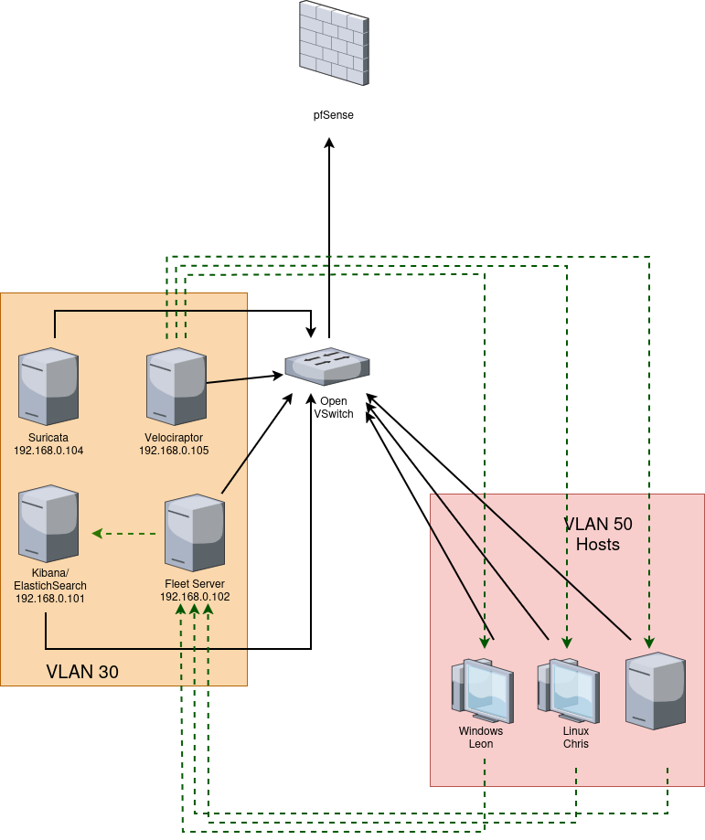

# **SOC Home Lab**
So for a long time a was passionate about cyber security, at start I was interested in the red team part of the filed, but after some time I discovered the defensive side primarily the Security Operations Center and after some research I decided to start a home lab. So... here we are, I have made this GitHub page to track my progress and look back at the mistakes I've made.

# My Setup
For my setup i have an old laptop running as my Proxmox server. On the server I have four VM's: ElasticSearch/Kibana, a Fleet Server, Suricata in IDS mode and Velociraptor. The Windows and Linux VM's used for simulating attacks are running on my main PC since it is more powerfull. At the moment all the machines are on the same subnet, but I intend to buy another Network Interface (a USB to Ethernet) for my Laptop so i can setup pfSense and have the main services like elastic on a vlan and the victims machines on a separated vlan. 

